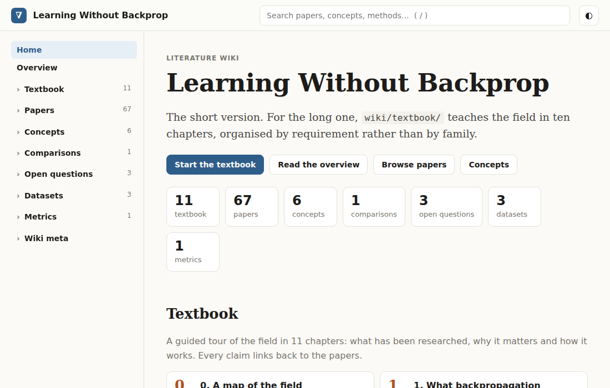
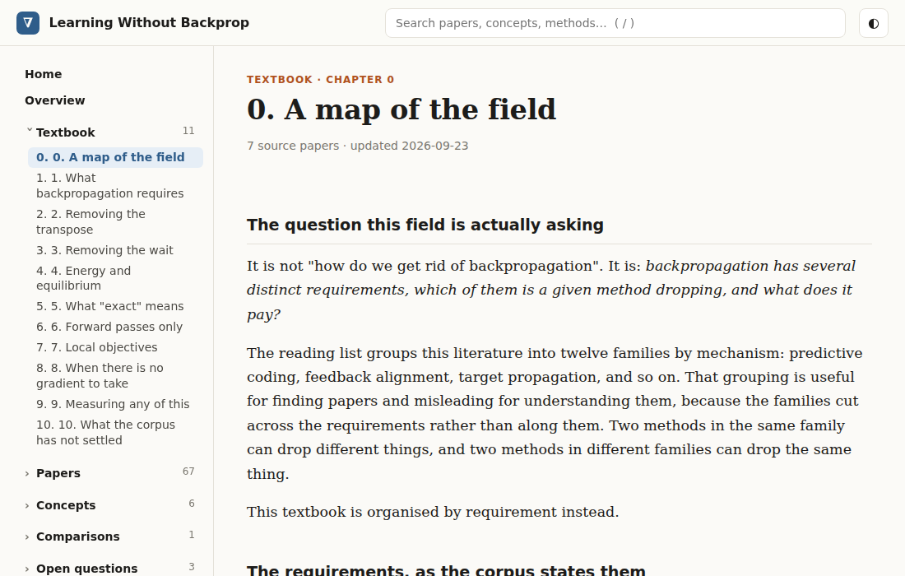
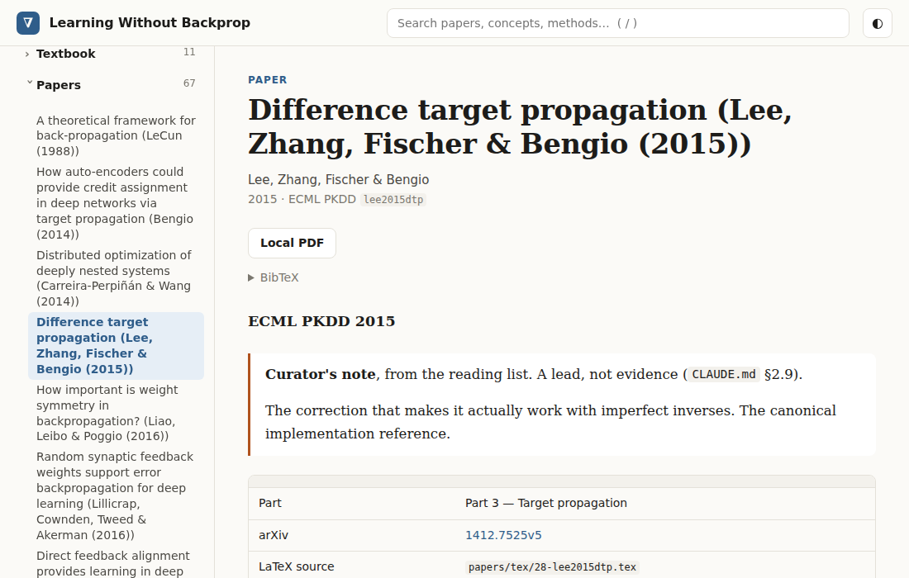
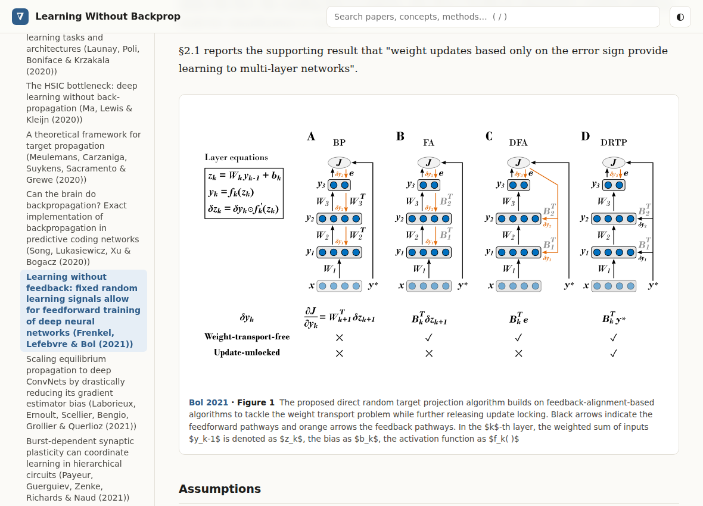

# Literature Wiki skill

An agent skill for building a source-grounded wiki from a curated collection of research papers. It scaffolds the project, helps collect open-access sources, guides paper-by-paper analysis and cross-paper synthesis, checks citations and evidence locators, and builds an offline static site with search and KaTeX math.

The skill lives in [`literature-wiki/`](literature-wiki/SKILL.md). Its `SKILL.md` is the agent entry point; `references/` holds writing guidance, `scripts/` holds the wiki tools, and `templates/` holds the editing contract and README copied into new projects. Five small command skills sit next to it, `/create-wiki`, `/add-papers`, `/wiki-exams`, `/serve-wiki` and `/update-wiki`, so the common tasks are one command away. It works with Codex and Claude skill directories.

## Example wiki

These screenshots show *Learning Without Backprop*, a literature wiki built with this workflow. Click an image to see it at full size.

<p align="center">
  <a href="docs/images/wiki-home.png"></a><br>
  <sub>Home page · Start with the textbook or browse the paper collection.</sub>
</p>

<p align="center">
  <a href="docs/images/textbook-chapter.png"></a><br>
  <sub>Textbook · A guided introduction to the topic, grounded in source papers.</sub>
</p>

<p align="center">
  <a href="docs/images/paper-page.png"></a><br>
  <sub>Paper page · Source details and navigation into the paper analysis.</sub>
</p>

<p align="center">
  <a href="docs/images/paper-figure.png"></a><br>
  <sub>Paper figures · Original diagrams appear inline with their source and caption.</sub>
</p>

Figure 1 in the last screenshot is from [Frenkel, Lefebvre and Bol (2021)](https://www.frontiersin.org/journals/neuroscience/articles/10.3389/fnins.2021.629892/full), © 2021 the authors, published under [CC BY 4.0](https://creativecommons.org/licenses/by/4.0/). The screenshot shows it within the example wiki.

## Install

### Claude Code marketplace (recommended)

In Claude Code, add this repository's marketplace and install the plugin:

```text
/plugin marketplace add Fuminides/literature-wiki-skill
/plugin install literature-wiki@fuminides-literature-wiki
```

This installs the main skill and all five commands together, including their scripts,
references and templates. Plugin commands have a namespace, for example
`/literature-wiki:create-wiki` and `/literature-wiki:serve-wiki`.

The plugin needs Python 3.10 or newer and these Python packages:

```bash
python3 -m pip install PyYAML markdown-it-py mdit-py-plugins Pillow
```

The source and figure tools also use `pdftotext`, `pdfinfo`, and `pdftoppm` from
Poppler (`poppler-utils` on Debian/Ubuntu, `poppler` on macOS with Homebrew).
`detex` and Ghostscript (`gs`) are optional. Node.js is needed only for the optional
math check. Plugin installation does not install these system dependencies; the skill
checks them before starting a wiki.

To update later, run this in your shell:

```bash
claude plugin update literature-wiki@fuminides-literature-wiki
```

This is a repository-hosted marketplace. Appearing in Anthropic's public directory
requires a separate [directory submission](https://code.claude.com/docs/en/plugins/publish#submit-to-anthropics-directory).

### Manual installation (Codex or standalone Claude skills)

Clone the repository, install Python 3.10 or newer, then install the script dependencies:

```bash
git clone https://github.com/Fuminides/literature-wiki-skill.git
cd literature-wiki-skill
python3 -m pip install -r requirements.txt
```

Copy the skill and its commands into the agent's skill directory. For Claude Code:

```bash
mkdir -p ~/.claude/skills
cp -R literature-wiki create-wiki add-papers wiki-exams serve-wiki update-wiki ~/.claude/skills/
```

For Codex, use `~/.codex/skills/` in both commands. The command folders must sit next to `literature-wiki`, whose scripts and guides they use. Install the system dependencies described above too. You can also use the scripts directly from the cloned repository without installing the agent skill. Choose either the plugin or the standalone Claude skills to avoid duplicate commands.

## Start a wiki

With the Claude Code plugin, type `/literature-wiki:create-wiki` followed by whatever you have: a paper list, a file, a folder of PDFs, or just a topic.

```text
/literature-wiki:create-wiki causal discovery from observational data, papers in ~/reading/causal.bib
/literature-wiki:create-wiki a wiki on hypernetworks from the PDFs in ~/papers/hypernetworks/
/literature-wiki:create-wiki program synthesis with LLMs
```

It works out the wiki's name, topic and directory and builds the corpus from your input. Given only a topic, it proposes a reading list and waits for your approval. It confirms everything once, then runs every phase: downloads, paper pages, synthesis, textbook, site and exams. A full build is long, so it reports after each phase and pilots the first pages before writing the rest.

| Command | What it does |
|---|---|
| `/create-wiki [topic, papers, file or folder, directory]` | Creates a wiki from whatever you have, as above. |
| `/add-papers [papers] [wiki]` | Adds papers to an existing wiki and carries them through the paper pages, synthesis, textbook, exams and site. |
| `/wiki-exams [level] [count] [wiki]` | Writes or extends the easy, medium and hard exams, piloting a few questions first. |
| `/serve-wiki [wiki] [--port N]` | Starts the site with the Ask Claude panel and graded exams, rebuilding it if the wiki changed, and gives you the URL. |
| `/update-wiki [wiki]` | Brings a wiki made with an older version of the skill up to date (chat panel, exams, fixes, README) and keeps its local changes. |

The table uses the short names. For marketplace installs, prefix each with
`/literature-wiki:`, for example `/literature-wiki:add-papers`. Manual Claude skill
installs use the short names directly.

The commands run only when you type them. Plain requests work too, because the `literature-wiki` skill picks up requests such as “create a wiki about causal discovery from these papers in `./causal-wiki`”. In Codex, ask for a command's skill by name, for example “use create-wiki with `~/reading/causal.bib`”.

### Without the agent

To scaffold a project directly:

```bash
python3 literature-wiki/scripts/init_wiki.py ./causal-wiki \
  --name "Causal Discovery" \
  --topic "Methods and evidence for causal discovery from observational data."
cd causal-wiki
python3 .tools/lint_wiki.py
python3 .tools/build_site.py
```

The scaffold creates `papers.csv` for your curated corpus, `wiki/` for the pages, `.tools/` for the scripts and site assets, both `AGENTS.md` and `CLAUDE.md` with the project's evidence and editing rules, and a `README.md` that tells readers how to use the site, the chat and the exams. Fill `papers.csv` before the source collection phase. The generated site is in `site/` and can be opened directly from disk.

### Read, ask and practise

To ask questions while you read, run `/serve-wiki`, or `python3 .tools/serve_site.py`, and open the URL it prints (http://127.0.0.1:8765 unless that port is taken). Every page then has an "Ask Claude" panel that knows which page you are on and any passage you highlight, and answers with links into the wiki. It needs [Claude Code](https://claude.com/claude-code) installed and logged in.

The site can also hold easy, medium and hard exams that test understanding of the field rather than recall of individual papers. Multiple-choice questions are graded in the browser. When the site is served this way, Claude grades written answers and explains your mistakes. The server also counts how often each question has been answered, and once you have practised a level enough, Claude writes new questions for it. If the wiki has nothing significant left to ask at that level, the exam page says so instead.

The scripts contact arXiv or Semantic Scholar only when you run the source discovery and download commands. Download only copies you are allowed to use. The vendored KaTeX files retain their own [MIT license](literature-wiki/scripts/site_assets/katex/LICENSE).

## Plugin development and releases

The plugin manifest explicitly lists the six existing skill directories, so marketplace
and manual installs use the same files and preserve the commands' sibling paths.
To validate both manifests and try a checkout locally:

```bash
claude plugin validate --strict .claude-plugin/plugin.json
claude plugin validate --strict .claude-plugin/marketplace.json
claude --plugin-dir .
```

Before publishing a plugin update, increment `version` in
`.claude-plugin/plugin.json` and push the changes. Claude uses that version to decide
whether installed copies need updating. The marketplace install commands work once
these manifests are on the GitHub repository's default branch.

## License

The skill and original tools are available under the [MIT License](LICENSE).
